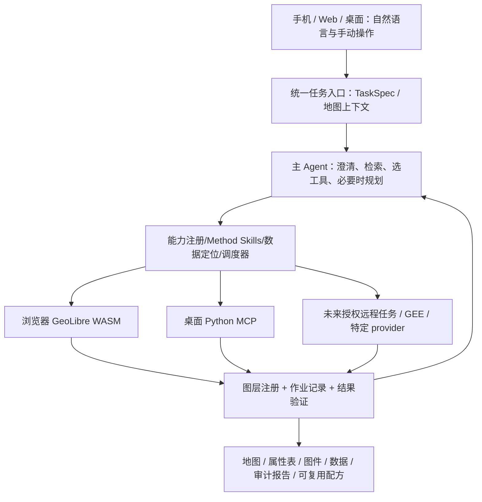

# TIPHYS：开源 GIS + AI 生态调查与分阶段开发总方案（V4）

> 版本：2026-10-24 · 定位：后续开发的决策与验收依据 · 状态：研究及实施建议，**不是已实现功能清单**
>
> 目标仓库：[eznine/Tiphys](https://github.com/eznine/Tiphys)；本轮参照的主分支提交 `cb0ec2f998a5d1528421c3be5f07be6976243a38`。本文不修改 TIPHYS 代码。

## 0. 一页结论：下一步究竟做什么

**产品目标**：让用户在电脑浏览器、手机浏览器、桌面客户端通过自然语言完成真实 GIS 任务；AI 不只是“调用一个工具”，而能检查数据、询问关键口径、挑选执行引擎、组织工具链、验证结果、呈现在地图上，并保存可复现成果。手机能做适合其内存与浏览器限制的真实分析（包括小数据量的水文等栅格任务），不是仅作数据采集器；重任务可以在用户许可下切换桌面或远程执行。

**首要判断**：TIPHYS 的当前瓶颈不是 GIS 算子太少。它已经有 GeoLibre WASM 大型工具库及 Python MCP 引擎，而两套 Agent 看见的工具、持有的数据、任务状态和验收机制没有统一。继续大量增加工具或直接微调模型，短期大概率不能解决“想半天却不会正确调用”的问题。

未来的差异化来自六件事：

1. **可靠的能力检索**：模型能在近千工具中找到可用者，看到准确的输入条件及参数，而非仅匹配工具名。
2. **跨引擎语义一致**：同一 GIS 目的可由浏览器 WASM、桌面 Python 或授权远程提供者执行；只承诺**语义兼容的部分**，不要求算法逐字节一致。
3. **显式数据上下文**：Agent 知道当前图层类型、CRS、单位、范围、字段、分辨率、规模、实际文件位置与历史，避免“猜图层”。
4. **有界、可恢复的调度**：简单动作直接执行，复杂动作才规划依赖与检查点；发生错误能解释、重试或询问，而不是无限思考。
5. **结果可验收、可复现**：空间分析“执行成功”不等于“结论正确”；把 GIS 专业方法规则和结果验收嵌入产品。
6. **多端同一任务**：手机、Web、桌面共享任务语义与验证结果，界面可不同，工具能力按数据和执行环境动态提供。

**主线推进顺序**：固定基线 → 工具/图层最小统一和 2 个跨引擎操作 → 检索、数据体检、5 操作契约 → 多步执行、状态和结果验证 → 真实任务基准及移动端小数据完整任务 → 水文/选址/生态示范工作流与交付。每阶段以验收门槛退出。

## 1. 调查范围、证据等级与边界

本轮以 GitHub **仓库 README、源码/目录、论文、官方项目文档**为优先依据，覆盖原文提到的项目、GeoLibre 生态、Agent 编排、Agent Skills、基准测试、GIS 基础库、遥感/水文/生态/图网络、WebGIS/移动端等。以下“可用”意为仓库提供某种能力，**不表示已经在 TIPHYS 中集成或经我们端到端实测**。

- **A（高）**：查看了官方代码、API/架构或可复现的测试说明；可用于确定设计方案，仍需 TIPHYS 本地验证。
- **B（中）**：核对官方 README 或开发文档；适合排候选，不可声称已解决 TIPHYS 兼容性。
- **C（待验）**：研究性方向、产品演示或第三方说法；只放探索池。

优先级：**P0 立即研究/接入试点；P1 核心稳定后；P2 垂直能力；P3 长期/条件触发**。复用方式：**直接（调用库/协议）**、**适配（写 provider/桥接）**、**借鉴（方法/架构/测试）**、**暂不引入**。优先级不由 GitHub 星标决定。用户计划开源，故本文**不以商业或闭源许可作为技术筛选门槛**；实际复制代码仍需要保留来源、版本、许可声明与必要归属，这是工程可追踪性问题。

### 1.1 TIPHYS 当前已具备什么（仓库快照，不是推测）

| 能力 | 已有实现 | 现在的问题 |
|---|---|---|
| 桌面 WebView / 手机 Web / 电脑浏览器 | Tauri、React、MapLibre 和移动适配；Android debug Capacitor 外壳已可构建（2026-10-25，真机 `NOT_TESTED`） | UI 统一不代表 Agent 与算子能力一致 |
| 浏览器 GIS 算子 | `geolibre-wasm`，浏览器目录已约 958 个 WASM schema；合并目录约 997 项（见 `CLIENT_PARITY.md`） | Agent 用 `search_browser_tools` → `run_browser_tool`，检索语义和参数语境薄弱 |
| 桌面分析 | Node Agent sidecar + Python MCP 引擎，约 34 个工具 | 桌面 Agent 原生只看到 Python MCP；用户手动能调用的 WASM 未必能由 Agent 调用 |
| 图层系统 | 前端地图层 + 浏览器 IndexedDB 原始数据 + Python 工作空间 | 缺少跨环境逻辑 LayerRef、来源、版本、执行可见性和数据搬运 |
| 任务 | 双端已有 job 轮询、取消、审批、事件和恢复机制 | 两边模型/状态、审批标记、产物验收方式尚不一致 |
| Agent | 两套 AI SDK 工具调用循环、上下文/日志基础 | `stepCountIs(8)` 的静态限制与复杂任务不匹配；没有统一任务级验收与能力调度 |

已核对具体代码位置：`src/lib/browser/agent.ts`、`src/lib/browser/search.ts`、`src/lib/browser/engine.ts`、`src/lib/dataLayers.ts`、`agent/src/server.ts`、`agent/src/mcp.ts`、`engine/tools.py`、`engine/jobs.py`。现有可复用能力须保留，不以“大统一”推倒重写。

## 2. 重点开源仓库雷达：它们做什么，TIPHYS 要学什么

### 2.1 核心 Agent、编排、可靠性、基准（最值得研究）

| 项目（官方仓库） | 它实际做什么 | TIPHYS 交集及具体可复用点 | 方式 / 顺序 / 依据 |
|---|---|---|---|
| [GeoLibre](https://github.com/opengeos/GeoLibre) | 多端 GIS 工作台，广泛使用浏览器 WASM、地图和表格能力 | **当前最直接的上游**：工具目录、WASM 运行时、常见 GIS 工作台交互、跨端 UI | **直接+借鉴 / P0 / A**；避免复制第二套引擎 |
| [geolibre-rust](https://github.com/opengeos/geolibre-rust) | GeoLibre 的 Rust/WASM 核心和 CLI/工具入口 | 核验 JS/WASM 参数、输出、文件系统抽象；兼容浏览器和 Node 的实际约束 | **直接+适配 / P0 / A** |
| [GISclaw](https://github.com/geumjin99/GISclaw) | 自然语言 GIS Agent，确定性算子优先、代码补位、运行轨迹/产物保存 | **最值得借鉴的可靠性设计**：工具运行证据、不可悄悄覆盖成果、回放、方法模板、数据检查 | **借鉴 / P0 / A**；论文版本和当前代码分开评价 |
| [GeoAgent / OpenGeoAgent](https://github.com/opengeos/GeoAgent) | 通用 GeoAgent 框架，注册不同地理库工具并绑定 live map/会话对象 | 可参考 **GeoToolRegistry + GeoAgentContext**，如何把图层、地图、多个工具来源给一个 Agent | **借鉴 / P0 / A**；不要因此立刻换掉 TS/Node Agent |
| [qgis-whitebox-agent](https://github.com/opengeos/qgis-whitebox-agent) | 以自然语言查询 WhiteboxTools 处理链，动态算法发现、schema 参数验证和自动加载结果 | **贴近 TIPHYS 的低成本验证**：工具目录检索、参数校验、运行后入图层 | **借鉴 / P0 / A**；其 QGIS 宿主不必移植 |
| [RustGIS](https://github.com/opengeos/RustGIS) | Rust 桌面 GIS，命令 ID、模型构建、扩展与 AI | 借鉴**统一命令总线**：按钮与 Agent 调同一语义操作；不必另造 Rust 客户端 | **借鉴 / P1 / A** |
| [qgis-mcp](https://github.com/nkarasiak/qgis-mcp) | 通过 MCP 将 QGIS 操作暴露给 AI，按工具组组织插件能力 | provider 工具元信息、按需暴露、桌面应用状态同步；也可选做 QGIS 桥 | **借鉴/可选适配 / P1 / B**；工具数动态变化，不能沿用旧报道的 51 |
| [GeoAgents](https://github.com/juaquicar/GeoAgents) | GIS Agent 规划、空间工具执行、假设验证、重规划与追踪 | 参考任务状态/验证接口与重新规划触发；不照搬多 Agent 个数 | **借鉴 / P1 / B** |
| [GLEN / geo-agent](https://github.com/boettiger-lab/geo-agent) | MapLibre + DuckDB/结构化数据查询 + AI 地理分析 | **结构化属性/统计类任务**值得参考 SQL + 地图状态联动，未来浏览器 DuckDB-WASM | **借鉴+适配 / P1 / A** |
| [GeoFaham](https://github.com/microsoft/GeoFaham) | AutoGen 多专业 Agent 联合 STAC、OSM、PostGIS、栅格处理和可视化 | 参考数据源连接器、STAC 工作流、服务端 TiTiler；**不要默认采用多 Agent 以免延迟和错误放大** | **借鉴 / P2 / A** |
| [GIS Copilot / SpatialAnalysisAgent](https://github.com/GIS-Copilot/SpatialAnalysisAgent) | 面向 QGIS 的自然语言空间分析及研究评估 | 抽取典型 GIS 用户任务、参数歧义与失败类别，对比自己的测试场景 | **借鉴 / P1 / B** |
| [LLM-Geo](https://github.com/gladcolor/LLM-Geo) | 早期自然语言→GIS Python 代码和流程图 | 代码规划与输出可解释性的历史参考；不建议把“自由生成脚本”设为默认路线 | **借鉴 / P3 / B** |
| [geo-sleuth](https://github.com/Oldcircle/geo-sleuth) | 地理照片定位 Agent Skill，多脚本过滤/打分、模型最终裁决 | 关键是**先确定性缩小候选，再由模型决策**；GIS 数据来源必须可追踪 | **借鉴 / P1 / A**；照片定位不是当前核心功能 |
| [gods-eye-view](https://github.com/bilawalsidhu/gods-eye-view) | Cesium 三维情报/地图聚合，语音指令、场景工具与 MCP | 参考地图上下文、语音行动工具和 3D 图层交互；并非完整 GIS 分析引擎 | **借鉴 / P3 / B** |
| [TRIDENT](https://github.com/yuiseki/TRIDENT) | 文字需求转 Overpass/OSM 结构化检索、尝试本地小模型 | 后续“找某区域道路/建筑/河流”等**数据发现**入口；先验证区域/过滤条件 | **适配 / P2 / B** |
| [geo-mcp-servers](https://github.com/sparkgeo/geo-mcp-servers) | 持续收集和分类地理 MCP 服务的索引，不是计算引擎 | 以后需要 STAC、地理编码、OSM、PostGIS、天气时查这里，按来源选定 provider | **候选索引 / P2 / B** |

**不要从这些仓库直接得出“多 Agent 一定更强”**。GISclaw 的受控研究在其测试设置中，较强模型的单智能体 ReAct 有时优于双 Agent 计划—执行—重规划；这个结论只适用于论文设置，TIPHYS 必须自行 A/B。复杂任务需要“计划和检查点”，不等于需要第二个语言模型 Agent。

### 2.2 GIS Agent Skills 与方法知识：补足“模型会调用却不懂 GIS”

| 仓库 | 它提供什么 | 对 GeoAgentKnowledge / TIPHYS 的动作 | 方式 / 顺序 |
|---|---|---|---|
| [muend/geoai-skills](https://github.com/muend/geoai-skills) | 18 种 GIS **方法学护栏**：CRS/单位、样本和空间泄漏、叠加/重复计数、变化检测可比性、统计推断、不确定性等；明确算子成功不等于结论成立 | **P0 必读**：将规则拆成触发条件、输入前提、失败例、运行后验证、无法判断时的拒答/追问；适当移植至现有 GeoAgentKnowledge | 借鉴 / **P0** |
| [opengeos/geoai-skills](https://github.com/opengeos/geoai-skills) | 基于 Python GeoAI 的数据检查、STAC 检索、遥感模型等专门 Skill | 做“数据检查/检索”配方；Python 背景依赖不要放进手机 | 借鉴 / P1 |
| [isaaccorley/geospatial-skills](https://github.com/isaaccorley/geospatial-skills) | GDAL、GeoParquet、GeoZarr、PMTiles、地图前端、数据流水线等独立 Skill | 优先借鉴 GDAL/GeoParquet 验证和 PMTiles 交付；不需要全包安装 | 借鉴 / P1 |
| [danmaps/gis-agent-skills](https://github.com/danmaps/gis-agent-skills) | GIS/ArcPy 数据质量、空间分析、制图交付及可读规则 | 对照 GeoAgentKnowledge 的“通用性/负例/验收”结构，避免知识库全是具体医院/社区例子 | 借鉴 / P1 |
| [maplibre-agent-skills](https://github.com/maplibre/maplibre-agent-skills) | MapLibre 地图开发 Agent 指令集 | 帮助地图 UI/性能/移动适配开发代理，不直接提升 GIS 计算正确性 | 借鉴 / P2 |
| [mapbox-agent-skills](https://github.com/mapbox/mapbox-agent-skills) | 地图平台 SDK/交互技能 | 只选可迁移的交互/调试规范；不能把 Mapbox API 等同 MapLibre | 借鉴 / P3 |

**知识与工具必须分层**。`tool card` 写“函数参数/执行边界”；`method skill` 写“地理条件、应该怎么设计流程、容易犯的错误、验收方式”；`recipe` 写“已验证的端到端操作范例”。单纯用向量搜索上百篇文章，不能替代显式输入前提与程序化验证。

### 2.3 GIS / 遥感 Agent 的测评与训练资料（决定如何衡量改进）

| 项目 | 真实提供的资源 | 与 TIPHYS 的价值 / 优先级 |
|---|---|---|
| [GeoAgentBench](https://github.com/pothos-dev/geoagentbench) | **36 项**六类 GIS 任务（发现数据、格式、CRS、几何、空间分析、清洗），包含输入、标准产物与确定性评分器；黑盒 HTTP 适配 | **P0**：从中选择可兼容任务建立 TIPHYS 回归集，不能直接把它的百分比和自建集混成一个分数 |
| [GeoAnalystBench](https://github.com/GeoDS/GeoAnalystBench) | **50 项**经专家设计的真实空间分析任务和工作流/代码评价资源 | **P1**：补充多步骤、复杂业务任务；需核查输入可用性和评分实现 |
| [GeoNatureAgent Benchmark](https://github.com/gabrielireland/GeoNatureAgent_Benchmark) | **103 项**（93 主集 + 10 扩展），自然语言控制地理 API 的工具选择、错误恢复、比较和时序评测 | **P1**：有利于比模型/检索/多 Agent；作者公布的分数只代表其任务与接口，非 TIPHYS 预期成绩 |
| [ThinkGeo](https://github.com/mbzuai-oryx/ThinkGeo) | **486 项**遥感结构化任务，含光学和 SAR，强调工具链步骤准确性 | **P2**：准备遥感专项基准，尤其防止“空间描述正确、具体算子错” |
| [OpenEarthAgent](https://github.com/mbzuai-oryx/OpenEarthAgent) | 遥感 + GIS 工具增强 Agent、开源模型/轨迹；README 记录约 **14,538 训练 + 1,169 测试**样本 | **P2/P3**：先学轨迹格式/工具调用数据，后续考虑 4B 类模型局部微调；不把公开成绩等同 TIPHYS 实测 |
| [GISclaw 论文与仓库](https://github.com/geumjin99/GISclaw) | 确定性算子、运行日志和单/双 Agent 对照评估 | **P0**：任务错误分类和“成功 ≠ 正确”评分设计；当前仓库可能已偏离论文冻结实现 |

**评测基准要覆盖四种不同能力**：① 能否选对工具和参数；② 输出空间文件是否正确；③ 最终文字结论是否有依据；④ 用户能否拿到可打开可复现的交付物。每种能力分别计分。

### 2.4 实际空间计算与数据处理库（“工具从哪里来”）

| 仓库 | 作用 | TIPHYS 的具体建议 | 顺序 |
|---|---|---|---|
| [WhiteboxTools](https://github.com/jblindsay/whitebox-tools) | 水文、地形、地貌、栅格及矢量算法 | **P0 水文验证重点**，先明确 GeoLibre 中到底暴露了哪个算法、版本、输入输出，别重复包一套 |
| [whitebox_next_gen](https://github.com/jblindsay/whitebox_next_gen) | 下一代 Whitebox 算法开发 | 关注上游升级与性能，不马上迁移算法核心 | P3 |
| [GDAL](https://github.com/OSGeo/gdal) / [PROJ](https://github.com/OSGeo/PROJ) | 格式读取写入、栅格/矢量转换、投影 | 桌面 Python 引擎底座；CRS 真变换、栅格 metadata、格式交付应以此交叉验证 | P0 |
| [GeoPandas](https://github.com/geopandas/geopandas) / [Shapely](https://github.com/shapely/shapely) | Python 矢量处理与几何运算 | 已有桌面执行路线；封装为统一 tool provider，不暴露原始文件路径给模型乱猜 | P0 |
| [Rasterio](https://github.com/rasterio/rasterio) | 栅格 IO、窗口读取、重投影和元数据 | Python 栅格执行与验证的关键，不强求在手机移植 Python | P0 |
| [GRASS GIS](https://github.com/OSGeo/grass) | 成熟水文、地形、时空 GIS 算子体系 | 桌面/远程可选高级 provider，先在少量水文参照案例交叉验证，不全量引入 | P2 |
| [QGIS](https://github.com/qgis/QGIS) | Processing 注册、Provider、算法参数与模型构建器 | 学它**provider/参数/反馈/历史**范式；QGIS 依赖是可选桥，不是 TIPHYS 必需宿主 | P1 |
| [DuckDB Spatial](https://github.com/duckdb/duckdb-spatial) | 列式数据与空间 SQL | 字段清洗、统计、GeoParquet、分区和海量表格；Web/桌面可各自适配，按 SQL/空间语义测 | P1 |
| [Turf.js](https://github.com/Turfjs/turf) | JS 常用几何操作 | 浏览器轻量预处理和验证辅具，不用它替代现有 GeoLibre 地理处理系统 | P1 |
| [geotiff.js](https://github.com/geotiffjs/geotiff.js) | 浏览器 GeoTIFF 读取、块解码、元数据 | 手机与 Web 栅格数据体检/小数据窗口读取；性能与内存需实测 | P1 |
| [PySAL](https://github.com/pysal/pysal) | 空间统计、空间权重、自相关、空间计量生态 | 莫兰指数、热点与空间统计进入后续专业工作流，先检查统计假设 | P2 |
| [pysheds](https://github.com/pysheds/pysheds) | Python DEM 流向、汇流、流域划分 | 小水文工作流的 Python **对照算法**候选，注意 D8、NoData、洼地处理必须同口径 | P1 |

注意：**GeoLibre、WhiteboxTools、GDAL、GeoPandas 不是可以简单做等号的产品**。GeoLibre 是宿主与浏览器算子生态，部分工具的底层算法/编译路径来自其他项目；Whitebox 是算法族；GDAL/PROJ 是数据与空间参考基础；GeoPandas/Rasterio 是 Python 层实现。下游 Tool ID、依赖与实际 provider 必须在代码中追踪，不能凭“名字像”判定。

### 2.5 数据、WebGIS、可视化、网络与遥感（按任务选择）

| 仓库 | 实用功能 | TIPHYS 借鉴/复用 | 顺序 |
|---|---|---|---|
| [MapLibre GL JS](https://github.com/maplibre/maplibre-gl-js) | 浏览器地图渲染、图层交互 | **现有主地图**，持续复用；提高 Agent 选中高亮、对比、结果可视解释 | P0 |
| [deck.gl](https://github.com/visgl/deck.gl) | WebGPU/WebGL 海量点、轨迹、栅格等可视化 | 大数据图层表现瓶颈出现时按需加，不预先叠一套地图 | P2 |
| [CesiumJS](https://github.com/CesiumGS/cesium) | 三维地球、3D Tiles、时空场景 | 3D 专项需求时再做地图视图切换；对多数 2D 分析不是短期必要 | P3 |
| [PMTiles](https://github.com/protomaps/PMTiles) | 单文件瓦片归档与云端/离线使用 | 分享工作区地图和离线数据包候选；需测移动端离线缓存 | P1 |
| [TiTiler](https://github.com/developmentseed/titiler) | 服务端 COG 动态栅格瓦片 | 大影像显示可选远端服务，**不是客户端分析引擎** | P2 |
| [STAC Browser](https://github.com/radiantearth/stac-browser) | 卫星影像 STAC 目录浏览 | 数据发现交互与查询条件参考；维护状态需复核 | P2 |
| [geemap](https://github.com/gee-community/geemap) / [leafmap](https://github.com/opengeos/leafmap) | Python GEE/地图交互与数据分析工具箱 | 研究 GEE、STAC 数据工作流与用户体验，不要将 Python 笔记本 UI 硬移植到手机 | P2 |
| [OSMnx](https://github.com/gboeing/osmnx) | OSM 城市街道网络构建/分析 | 交通设施可达性与网络分析的 Python provider | P2 |
| [OSRM](https://github.com/Project-OSRM/osrm-backend) / [Valhalla](https://github.com/valhalla/valhalla) | 道路路径规划引擎 | **真正沿路路径**而非直线距离；若地图网络分析需求增加再部署 | P2 |
| [City2Graph](https://github.com/c2g-dev/city2graph) | 道路、公交 GTFS、建筑、OD/POI 转图及异构图分析 | 选址、交通可达性、网络结构；与空间数据解析分开保存图语义 | P2 |
| [r5py](https://github.com/r5py/r5py) | 多模式公共交通可达性 | 公交网络和时间变化的专业进阶计算，不必早期引入 Java 栈 | P3 |
| [segment-geospatial / SamGeo](https://github.com/opengeos/segment-geospatial) | 基于 SAM 的遥感分割，地理栅格输入与矢量输出 | **专题影像分割**可选桌面/GPU provider；需后处理和精度验证，不能把掩膜直接当可用河流/道路网络 | P2 |
| [geoai](https://github.com/opengeos/geoai) | 遥感分类、分割、检测模型和 QGIS 组件 | 未来多模型 Provider 候选，优先测试“植被/水体”等明确任务 | P2 |
| [TorchGeo](https://github.com/torchgeo/torchgeo) / [TerraTorch](https://github.com/IBM/terratorch) | 遥感模型数据、训练及微调生态 | 若积累真实标注数据再做专项模型；不要拿模型微调替代 Agent 工具调度 | P3 |

**单独提醒——地形图/扫描图的河流道路矢量化**：先用颜色、形态学、线宽/连通域和拓扑规则处理制图符号清晰的地图；影像没有稳定制图颜色、目标复杂或需要语义理解时才调用 SamGeo/其他分割模型；最后必须做骨架化、端点连接、拓扑与抽样精度检查。模型输出的像素掩膜不是合格的河网或路网。这个能力可作为独立实验包，不应先污染整个 Agent 的默认工具选择。

### 2.6 生态与专业地理工作流、外业生态

| 仓库 | 作用 | TIPHYS 使用时机与约束 | 顺序 |
|---|---|---|---|
| [InVEST](https://github.com/natcap/invest) | 生境质量、碳储量、产水、营养/泥沙等生态系统服务模型 | **精选 Python 专业 provider**；模型需要严格参数/数据表预检、来源与结果解释，不要一键跑全家桶 | P2 |
| [Linkage Mapper](https://github.com/linkagescape/linkage-mapper) | 生态源地和最小成本廊道等工作流 | **借鉴专业步骤和概念**，无需原样迁移对 ArcPy 宿主的依赖 | P2 |
| [Circuitscape.jl](https://github.com/Circuitscape/Circuitscape.jl) | 电路理论景观连接度建模 | 进阶电流连通性，与最小成本路径不同；桌面/远程 Julia provider 与真实案例校验 | P3 |
| [Omniscape.jl](https://github.com/Circuitscape/Omniscape.jl) | 多尺度/全景生态连通性分析 | 大栅格和计算成本更高，生态垂直领域成熟后再引入 | P3 |
| [pylandstats](https://github.com/martibosch/pylandstats) | 景观格局指数与斑块指标 | 土地利用/生态源地量化评价，桌面 Python 专业 provider | P2 |
| [QField](https://github.com/opengisch/QField) / [QFieldCloud](https://github.com/opengisch/QFieldCloud) | QGIS 工程移动离线编辑、外业表单和同步 | **认真借鉴离线、GPS 精度记录、冲突处理**；它们已很成熟，TIPHYS 不应把“手机能编辑”当独有价值 | P2 |
| [Mergin Maps mobile](https://github.com/MerginMaps/mobile) | 移动 GIS 外业与工程同步 | 实际离线工单、表单、多媒体、版本冲突的交互参照 | P2 |
| [ODK Collect](https://github.com/getodk/collect) | 离线调查表单与位置/附件采集 | 若开展外业闭环，借鉴严格表单约束，不替代专业 GIS 分析 | P3 |

### 2.7 研究列表的核心取舍

**马上融入 TIPHYS 核心设计（不是照抄源码）：** `GeoLibre` 原工具能力、`GISclaw` 追踪和审计、`OpenGeoAgent` 上下文注册、`geoai-skills` 方法核验、`GeoAgentBench` 结果评分、`qgis-whitebox-agent` 参数检验、`RustGIS` 统一命令接口。

**新工作流出现才加：** DuckDB Spatial、pysheds、OSMnx、InVEST、SamGeo、PMTiles、STAC/TiTiler、图网络。**明确后置：** 复杂三维场景、全面数据云服务、遥感基础模型微调、纯语音操控、沉重的生态电路网络或 GNSS 工程级测绘。

## 3. 最终推荐架构：一条任务链，多个执行器



### 3.1 统一的**不是**所有实现，而是 GIS 行为契约

区分四层：

1. **Semantic Operation（少量公共语义）**：如 `gis.buffer`、`gis.reproject`、`gis.clip`、`gis.dissolve`；定义通用输入、单位、产物和验收。
2. **Provider（具体实现）**：`wasm:buffer_vector`、`python:buffer`、未来 `remote:buffer`；适配器转换参数，但不得掩盖算法差异。
3. **Native Tool（大量原生专业能力）**：Whitebox 水文、栅格工具和平台独有算法继续以原生 ID 暴露，不为近千工具做假“全引擎对等”。
4. **Recipe/Method Skill（完成任务的知识）**：说明为什么选择某算法、前置条件、关键参数、风险和怎样验证。

第一个试点只做 `buffer + reproject` 两项语义操作；后续补 `clip + dissolve + zonal_statistics`。`zonal_statistics` 已按“矢量分区 + 栅格取值”在桌面 Python 新增并做合成数值验证；浏览器同名 WASM 工具只接受栅格分区，仍不映射。不得未经数据验收就宣布“两个引擎已统一”。

### 3.2 最少共享的六种数据对象

以下为建议的**接口草案**，不是已存在的代码：

```ts
type EngineId = 'browser-wasm' | 'desktop-python' | 'remote';

interface LayerRef {
  id: string;                 // 逻辑图层 ID，不等于本地文件路径
  name: string;
  type: 'vector' | 'raster' | 'table';
  ownerEngine: EngineId;       // 真正持有分析数据的一端
  nativeRef: string;           // provider 私有的图层/对象引用
  crs?: string;
  geometryType?: string;
  featureCount?: number;
  bounds?: [number, number, number, number];
  raster?: {width: number; height: number; pixelSize?: [number, number]; nodata?: number};
  fields?: Array<{name: string; type: string}>;
  contentHash?: string;
  derivedFrom?: string[];
  version?: number;
}

interface TaskSpec {
  id: string;
  goal: string;
  inputLayerIds: string[];
  constraints: Record<string, unknown>; // CRS/单位/研究范围等显式约束
  expectedOutputs: Array<{kind: 'layer' | 'table' | 'map' | 'report'; name?: string}>;
  unresolvedQuestions: string[];        // 必须由用户澄清或声明假设
  acceptanceRules: string[];            // 目标是否达成的任务专用断言 ID
}

interface OperationSpec {
  id: string;                  // gis.buffer；稳定语义 ID
  version: string;             // 契约可演进，不静默改变语义
  inputs: unknown;             // 运行时 JSON Schema / Zod 约束
  outputs: unknown;
  requires: string[];          // 例如 projected-distance, valid-polygon
  sideEffect: 'read' | 'create' | 'modify' | 'delete';
  capabilities: string[];     // 如 raster, vector, job, cancel
}

interface ProviderCapability {
  operationId: string;
  engine: EngineId;
  nativeToolId: string;
  supportedInputs: string[];
  limits?: {maxBytes?: number; maxPixels?: number; memoryEstimate?: number};
  semanticDifferences?: string[];
}

interface ExecutionRun {
  runId: string;
  userGoal: string;
  inputLayerIds: string[];
  toolCalls: Array<{id: string; params: unknown; engine: EngineId; durationMs?: number; status: string}>;
  outputLayerIds: string[];
  artifactIds: string[];
  validation: Array<{rule: string; status: 'PASS' | 'WARN' | 'FAIL' | 'NOT_TESTED'; details?: string}>;
  status: 'created' | 'running' | 'waiting_user' | 'completed' | 'failed' | 'cancelled';
}

interface ArtifactManifest {
  id: string;
  runId: string;
  type: 'vector' | 'raster' | 'table' | 'map' | 'report' | 'recipe';
  uri: string;                        // 非模型随意编造的资源定位
  sourceLayerIds: string[];
  checksum?: string;
  crs?: string;
  verified: boolean;
}
```

真正编码时需补权限、唯一性、路径安全、敏感信息脱敏、schema 版本、数据大小与容差。**LayerRef 不代表自动同步原始数据**：跨 provider 执行前明确 `canAccess`，需要搬运时创建转换任务、估算数据量并让用户知晓；不能把 IndexedDB URL 当桌面文件路径。

### 3.3 WASM 与 Python 到底如何共用

- **能共用**：Agent 可见的能力 ID、输入语义、图层元数据、作业状态、错误分类、结果产物、方法知识、验证逻辑与前端工作流。
- **不必共用**：内存模型、第三方算法实现、原生参数名称、某些数据格式、计算成本、数值精度、执行位置。
- **必要边界**：桌面 Node Agent 需要获得 WebView GeoLibre WASM 的调用途径（安全的消息/请求桥），或用经过验证的 Node/WASI shim 执行。GeoLibre 使用的 WASI shim 是带内存文件系统的接口，**不能假定 `node:wasi` 能直接读任意桌面路径**。先做一个小样本 spike，比是否延续 WebView 桥、Node shim 或仍由现有浏览器 Agent 代理执行更稳。
- **跨引擎测试**：不仅比较名称相同的操作，还要逐一比较缓冲距离单位、投影选择、无效几何策略、裁剪几何类型支持、空结果、字段聚合、nodata、输出 CRS；允许由契约定义的容差，不要求二进制相同。

### 3.4 Agent 只需要看少量稳定入口，而非 1000 个大 schema

建议顶层工具：`inspect_workspace`、`search_capabilities`、`get_tool_schema`、`execute_operation`、`get_job_status`、`validate_result`、`export_artifact`、`ask_user`；仅向模型注入当轮候选工具的详细 schema，其余**按需加载**。在状态较清晰时可以一次把 5–12 个候选工具送入上下文，而不是对每个工具反复检索。

检索使用：中文别名/英文词/工具分类 + 符合 layer type/CRS/平台的过滤 + BM25/词法加权 + 少量模型重排。**不是一开始就上 embedding**。离线小工具搜索和 GeoAgentKnowledge 规则先改造高频歧义：如“按 500 米缓冲”“提取流域”“统计某行政区 NDVI”。

调度策略：

| 输入难度 | 行为 | 为什么 |
|---|---|---|
| 简单 UI/图层动作 | 直接命令：显示图层、缩放全图、改符号、打开表 | 不需要多轮模型“规划” |
| 单个明确地理操作 | `inspect → preflight → execute → validate` | 一步 GIS 算法仍需要坐标/数据验证 |
| 多个有依赖的操作 | 主 Agent 给出紧凑计划，执行器维护依赖关系、检查点、状态 | 模型做规划，程序做流程控制，减少错误累计 |
| 需要专业判断/口径不足 | 只询问对结果有重大影响的参数 | 不能编造投影、阻力权重、流域出口、重分类阈值 |
| 不支持或资源不足 | 展示原因；提供数据裁剪、降采样、换桌面/授权远程 | 诚实说明能力边界和预期误差 |

具体优化：取消对所有任务僵硬的 `8-step` 作为唯一上限，改为**基于任务类别的调用/时间/token/费用四重预算**；超预算返回当前成果和缺口，不能无限循环。计划并非每次强制画 DAG；失败重试只针对可重试错误；不可默默重算或覆盖用户数据。

### 3.5 结果验证：比“工具返回 ok”多一步

| 层级 | 必做校验 | 特殊例子 |
|---|---|---|
| L0 输入与约束 | 图层存在、可读、CRS、几何/栅格类型、参数单位和范围 | 经纬度数据请求“500 米”：先选择可靠距离方法，不能默默按度缓冲 |
| L1 执行产物 | 文件/图层可打开，合理 bounds、feature count、字段、栅格 nodata、数据类型 | 工具返回 job 成功但文件为空：不能判交付完成 |
| L2 语义与关系 | 任务特定断言 + 数值/几何不变量 | 重投影不应只改 CRS 标签；面裁剪结果必须落入 mask（按几何容差）；河网需要水文连通和流向合理性 |
| L3 业务结论 | 证据链、方法/参数来源、必要的敏感性/基准对照 | 生态阻力权重缺来源时，允许算例展示但不得称为科学结论 |

**验证不可以写死错误的不变量**：缓冲后面积未必“严格大于原面积”（复杂几何和负缓冲除外）；栅格重投影像元数也未必相同；面裁剪要考虑几何有效性和边界容差。每条规则要有**适用条件、正例、负例、允许差异、未测试状态**。报告用 `PASS/WARN/FAIL/NOT_TESTED`，模型不能把 WARN/NOT_TESTED 说成已通过。

## 4. 分阶段研发路线：工作清单和验收门槛

> **执行进度（2026-10-24）**
>
> | 阶段 | 状态 | 证据 |
> |---|---|---|
> | 0｜测清现状 | ✅ 完成 | [BASELINE_STAGE0.md](BASELINE_STAGE0.md)、[CATALOG_AUDIT.md](CATALOG_AUDIT.md)、`docs/baselines/stage0/` |
> | 1｜公共契约 + 桌面 WASM | ✅ 完成 | [STAGE1_CONTRACTS_AND_WASM.md](STAGE1_CONTRACTS_AND_WASM.md)、commit `4cbf212` |
> | 2｜检索、方法、五操作 | ✅ 完成（缺口已记录） | [STAGE2_REPORT.md](STAGE2_REPORT.md)、[SEARCH_QUALITY.md](SEARCH_QUALITY.md)、[METHODS.md](METHODS.md)、[CROSS_ENGINE_SEMANTICS.md](CROSS_ENGINE_SEMANTICS.md) |
> | 3｜自适应调度与审计 | ✅ 完成 | [STAGE3_REPORT.md](STAGE3_REPORT.md)、`docs/baselines/stage3/`、commit 记录见 HANDOVER |
> | 4｜系统对照评测 + 手机 | ✅ 完成（仿真范围） | [STAGE4_REPORT.md](STAGE4_REPORT.md)：2026-10-25 全量 30 任务复跑 **30/30 PASS**（单次，P50 30 s / P95 146 s）；A/B 28→29/30（预算制修复 M09）、移动 9/9、GeoAgentBench 子集重评 **5/6**（Capetown 质心、KML、waterway 已修复；仅 Bangkok 大矢量 WASM 资源边界失败）；真机与 ≥3 次方差仍未做 |
> | 5｜完整价值任务 | 🔶 5A/5B/5C 子集完成 | [STAGE5A_HYDROLOGY.md](STAGE5A_HYDROLOGY.md)（河网纵向 8/8 + 敏感性）、[STAGE5B_GIS.md](STAGE5B_GIS.md)（服务圈纵向 4 半径 + 守恒）、[STAGE5C_ECOLOGY.md](STAGE5C_ECOLOGY.md)（最小成本廊道 3 合成阻力方案 + 成本单调性；真实生态模型未做） |
>
> 阶段 2 的"完成"指验收门槛满足：207 条标注检索、五操作覆盖/缺口矩阵、11 张方法卡（2026-10-25 增补类型化 CRS/单位/叠加重复计数护栏，以及真质心/局部米制投影卡）、CRS/单位前置校验。后续桌面 Python 的 `gis.zonal_statistics` 已实现并验证；浏览器 `gis.dissolve` 与浏览器 `gis.zonal_statistics` 仍不可用，在 [STAGE2_REPORT.md](STAGE2_REPORT.md) 与 `OPERATION_SUPPORT` 中标为不支持并给出降级路径。
> 阶段 3 的"完成"指：11 个真实 3–4 步任务（12 次运行）在确定性执行器上可执行/可安全中止/可断点恢复，运行记录可独立复算（sha256 重算 + auditRuns 不变量），故意制造的错误全部诚实失败；**不代表**模型在环成功率已测（阶段 4）、桌面端有计划执行器、客户端有回放 UI——见 [STAGE3_REPORT.md](STAGE3_REPORT.md) §8。
> 阶段 4 的"完成（仿真范围）"：2026-10-25 全量 30 任务复跑 **30/30 PASS**（单次，P50 30 s / P95 146 s，输入 428k tokens；与 inspect 语义修改有时间重叠，非冻结构建）；A/B 双臂曾跑 28→29/30（预算制消除"检索吃光步数"失败模式）、移动任务卡 9/9（含河网/服务圈卡）、GeoAgentBench 兼容子集重评 **5/6**（Capetown 质心、KML 属性/2D 导出、waterway 空几何过滤已修复；仅 Bangkok 21,660 面/64.5 万顶点触发 WASM 资源边界，已加浏览器矢量预算守卫诚实拒绝）。**真机、≥3 次方差、GeoAnalystBench 仍未做**——见 [STAGE4_REPORT.md](STAGE4_REPORT.md) §5/§7/§8。
> 阶段 5 的 5A/5B/5C 子集：河网、服务圈与最小成本廊道三条纵向有程序性验收 + 敏感性/守恒/单调性不变量 + 交付模板（[STAGE5A](STAGE5A_HYDROLOGY.md)/[STAGE5B](STAGE5B_GIS.md)/[STAGE5C](STAGE5C_ECOLOGY.md)）；5C 只用用户给定合成阻力，真实流域数据、路网距离、真实生态阻力/Circuitscape/InVEST 未做。

### 阶段 0｜测清现状，冻结可复现基线（P0）

**任务**

1. 从实际项目注册表导出工具清单：`id / 引擎 / 类别 / schema / 输入数据类型 / 需要文件还是内存 / 异步否 / 预计成本 / 可取消 / 错误码`，与 UI/Agent 实际可见数对账。
2. 确认 GeoLibre 具体绑定哪些 Whitebox/GDAL/Rust 实现；区分“目录存在”与“能调用且输出正确”。重点实测桌面 Agent 能否触达 WASM。
3. 建立 TIPHYS 自有**至少 30 项任务 × 每项 3 次**的固定基线：10 项 UI/单工具、12 项两至四步 GIS、8 项复杂/歧义/异常。包含中文表达、多图层、不同 CRS、栅格大数据、移动端、取消/重试。
4. 对每次运行记录模型版本、temperature、token/time、调用序列、选错工具、参数错、执行失败、结果错、验收漏检、文件路径/产物摘要。保留测试数据 hash。

**验收**：输出一份“按能力/端/引擎”的覆盖矩阵和成功率报告，不能只写工具总数；任何以后宣称“提升 XX%”必须复用同一批任务和受控条件。

### 阶段 1｜最小公共契约和桌面 WASM 可达性（P0）

**任务**

1. 不动既有 Agent 主循环，先新建可被前端/sidecar 共享的类型定义（例如 `packages/gis-contracts`），只包含 `OperationSpec / ProviderCapability / LayerRef / ExecutionRun / Validation`。
2. 实现 `gis.buffer`、`gis.reproject` 两个试点适配器（现成 WASM + Python），通过原有事件回传图层；手动入口与 Agent 都调用同一命令服务。
3. 用最短的实验比较 `WebView→WASM bridge` 与 `Node→WASI shim`，证明文件 IO、进程隔离、请求取消与地图结果回传；选择**一个**。保留当前桌面 Python Agent 的会话/审批/恢复测试。
4. 先添加只读 `inspect_layers`：图层数据位置、CRS、几何、字段、NoData、范围、版本摘要；执行端不能凭图层显示 URL 猜原始文件。

**验收**：同一桌面 Agent 能正确运行至少一个 WASM GIS 工具并把结果显示、保存；两项公共操作在指定标准数据和误差容差下通过；旧 UI 和取消/审批测试不退化。

### 阶段 2｜工具检索、知识与五个基础操作（P0）

**任务**

1. 建工具能力索引、中文同义词、数据类型/端能力过滤、精简候选 schema 和候选排序的离线回归测试。
2. 把 `gis.clip`、`gis.dissolve` 纳入公共契约；**单独设计 `gis.zonal_statistics` 新能力**并核查栅格/矢量输入、投影、掩膜、统计量、NoData、像元权重等，不能只凭工具名映射。
3. 从 GeoAgentKnowledge 与 `geoai-skills` 选取 6–10 张高频**通用方法卡**：缓冲与距离、重投影、叠置和字段保留、分区统计、DEM 水文、面积/长度统计、空间连接、网络分析、地图结论可证性。
4. 将每种技能写出触发词、前置条件、禁止误用、追问条件、验收规则、正反例；检索规则与工具目录分开测试。

**验收**：至少 200 条工具发现/别名测试拥有标注正确答案（Top-1/Top-5，误召回、不能执行率）；五操作具备明确能力覆盖/缺口说明；高频 CRS/单位错误可被前置校验拦下。

### 阶段 3｜自适应调度和审计闭环（P0）

**任务**

1. 将计划拆成“可执行操作 + 显式数据依赖 + 验收点”；主 Agent 规划，**确定性执行器**持有 job、重试、取消、超时、状态和检查点。简单任务不必进入复杂 DAG。
2. `run_id` 下保存任务原文、澄清结果、计划版本、工具 ID/参数、引擎、输入 hash/版本、耗时、日志与产物、验证状态；用户可在客户端查看与回放。
3. 统一 Job 的基本状态和错误分类：`INPUT_ERROR / UNSUPPORTED / RESOURCE_LIMIT / EXECUTION_ERROR / VALIDATION_ERROR / USER_CANCELLED`；跨端不丢任务归属和审批。
4. 增加“模型无法完成时的诚实反馈”：指出不能做在哪个节点、已有可交付中间成果是什么、接下来需要数据/用户确认/另一执行引擎。

**验收**：至少 10 个真实 3–6 步任务可执行、取消、恢复或安全中止；输出日志可由另一位开发者独立复算；故意制造的错误不能生成“成功完成”的假结论。

### 阶段 4｜系统对照评测 + 手机原生的分析体验（P0/P1）

**任务**

1. 用阶段 0 固定任务进行 A/B：旧检索 vs 新检索、旧 Agent vs 公共能力、单 Agent vs 有条件规划；相同模型/输入/预算/数据，报告任务成功率、正确率、工具正确率、延迟、token、修复次数，保留 95% 区间或至少样本数与波动。
2. 适配 GeoAgentBench 中适合当前数据/引擎的部分项目；补 GeoAnalystBench 等复杂试题。**每个外部基准单独报告**，不混算。
3. 手机端支持**完整任务卡**：自然语言输入 → 解释执行端与预计数据/时间 → WASM 本地分析 → 验收 → 地图图层 + 统计结果 + 分享/导出；UI 和桌面同源，但可用工具按资源与能力筛选。
4. 首批手机任务：缓冲/裁剪/叠加、图层统计、小面积 DEM 坡度或汇流/水系试点。加入像元/内存限额、Worker、加载反馈、前后台生命周期测试。

**验收**：390×844 等主流尺寸真机或移动仿真下至少 5 项非查看/非外业 GIS 任务，从自然语言到可检查结果闭环；断线、后台恢复、OOM、异常输入等有清楚降级行为；桌面体验不退化。

### 阶段 5｜展示 TIPHYS 真正价值的完整任务（P1/P2）

建议并行在产品层选择**一条最成熟的真实纵向流程**，每条都必须能交付、复算：

**A 水文（最适合先验证 Whitebox/WASM）**

> “给我一张 DEM，自动处理洼地、计算流向和汇流、按照阈值提取河网、以指定出口点划分流域，生成河流分级及统计，并在地图中显示。”

- 任务链：检查 DEM 投影与分辨率/NoData → 洼地处理或水文修复 → 流向 → 汇流 → 阈值提取/河网 → （需要时）流域/分级 → 栅格转线/矢量清理 → 结果验证。
- 核心歧义：流向算法 D8/MFD、洼地处理方式、汇流单位（格网个数还是面积）、河网阈值、出口位置和 snap 半径，需要合理默认值可说明，科学敏感参数应确认。
- 核验：用合成 DEM 和至少 2 个真实小流域；比较工具链、流域/河网连通性、空出口与边界、阈值敏感性。**不能只用屏幕上有蓝线证明正确。**

**B 常规 GIS（高频、最能测 Agent）**

> “对学校 1 公里服务圈内的居住区进行统计，按道路网络计算最近学校，分等级专题显示，导出 GeoPackage、Excel 与一页地图。”

- 任务链：数据体检 → 是否欧式距离/网络距离澄清 → 缓冲/路网 → 空间连接/统计 → 字段核查 → 结果出图与导出。
- 输出验收：数量守恒/计数口径、去重与跨边界分配规则、单位、无可达路径的处理、报告数字对得上数据；不能把直线距离假装路网最短路。

**C 生态（主线稳定后形成特色）**

> “在源地/阻力数据明确的情况下，比较两个阻力权重方案的生态廊道，生成结果图、差异解释和核查清单。”

- 先做最小成本距离与路径，后景观指标/MSPA/网络评价；有准确模型输入时再接 InVEST 生境质量、碳储量；电流连通性 Circuitscape/Omniscape 更后。
- 输出验收：阻力/权重来源、相同 CRS/栅格分辨率、来源地几何、成本距离与路径范围、敏感性分析、不得捏造生态机理与权重。

**验收**：所选纵向流程有完整示例输入、人工参考结果、程序性验收、日志和交付模板；在桌面/Web 至少一种执行端稳定复现，若手机资源允许再启用移动端。

### 阶段 6｜核心稳定之后：扩展工作流与多端协作（P2）

- 数据：STAC/COG、OSM、GEE 授权连接；数据发现必须标明集合/时间/尺度/云量/授权，而不是只说“已经下载”。
- 表达：可复用 Workflow Recipe（含参数模板、校验和版本）、批处理、项目保存与分享、打印布局与基础专题制图。
- 分析：PySAL 空间自相关、OD/路网、City2Graph、数据质量修复、Zonal 统计升级、变化检测/NDVI。
- 生态：InVEST 生境质量和碳，景观指数，专业廊道敏感性比较。
- 手机：离线瓦片/任务包、少量表单/外业和冲突同步可作为附加能力，**并不替代手机 GIS 分析**。
- 扩展：第三方 MCP/tool provider SDK，支持用户添加工具并定义参数 schema、单元测试、权限和结果元数据。

### 阶段 7｜长期/按需求触发（P3）

| 后置功能 | 触发条件 | 不提前做的原因 |
|---|---|---|
| 自训练 GIS 小模型/蒸馏/微调 OpenEarthAgent 等 | 已收集大量**真实、核验的** tool call 轨迹，且弱模型在固定基准上确实受限 | 数据质量、工具接口变化影响收益；8GB 显存亦限制训练/推理规模 |
| 多 Agent Planner/Critic 并行 | 同预算 A/B 证明复杂任务成功率显著提升 | 单 Agent + 确定性验证已能解决大量失败；多 Agent 会增加延迟与成本 |
| Cesium 3D/时间轴/语音地图 | 有明确 3D/情报可视化用户任务 | 表现层增强不等于 GIS 分析能力增强 |
| RTK/NTRIP、持续后台跟踪、测绘平差 | 真实外业用户与设备需求明确 | 手机 Web 权限/硬件限制，测试和维护成本高 |
| LiDAR、InSAR、摄影测量、复杂地学模拟、全套水文/生态模型 | 有领域验证数据、执行环境和维护人力 | 技术复杂，输出结果比运行成功更难验收 |
| 全部工具多引擎对等 / 自研 GIS 引擎 | 多个高频场景因上游缺陷明显受阻，且重写收益受测量证实 | 重复成熟生态劳动、升级维护压力巨大 |

## 5. 手机“复杂 GIS”能力的真实边界及调度

用户的判断有一个重要成立条件：**自然语言确实能替代一部分复杂 GUI 操作**，而现代浏览器的 WASM/Worker 也确实能运行不少严肃 GIS 算子。但它不会消除物理资源和数据条件。应按任务分工：

| 用户需求 | 手机本地 WASM | 电脑浏览器 WASM | 桌面 Python/可选远程 |
|---|---|---|---|
| 图层检查、矢量缓冲/裁剪、属性统计 | **优先**；数据小/中且内存足够 | 优先 | 兼容备用 |
| 小区域 DEM 坡度/水流/河网 | **技术上可试**，先做基准和资源限额，不承诺所有设备 | 较适合 | 高可靠备用 |
| 大范围高分辨率 DEM、多栅格、长时批量 | 限额后建议裁剪/降采样/移交 | 依赖设备内存和执行超时 | **优先** |
| InVEST、复杂网络、SAM/GPU 分割 | 不默认本地跑，仅在确有轻量实现后开放 | 视引擎/数据而定 | **优先** |
| 地图交互、结果解释、报告、分享 | 完整支持 | 完整支持 | 完整支持 |

**重要机制**：路由器提供 `capability availability + predicted memory/pixels + engine choice reason`，给用户选择“本机处理（可能慢）/降低分辨率（影响结果）/桌面继续/授权远程（涉及数据发送）”。离线则不能凭空调用云端。工作执行中手机可暂时锁屏时，不要承诺浏览器后台长期不间断运行；必要时持久化阶段产物与断点，真实测试浏览器生命周期。

## 6. 性能与可靠性：从“少思考”变成“少走错路”

不能简单把 `thought budget` 压到很低就得到好 GIS Agent。合适策略如下：

1. **把静态上下文变得短而准**：系统提示只放不变量和协议；历史输出压缩为图层 ID、统计摘要、审计指针；工具 schema 按需披露。
2. **把检索做可测量**：先发现 5–12 个候选，再给模型 schema；召回不足时扩大范围；不要把整套工具清单塞进上下文。
3. **让程序处理确定性条件**：参数校验、单位变换、图层存在性、重试/超时、结果核验由代码处理；模型不重复逐字反思日志。
4. **复用经过实测的 recipe**：如 DEM 河网、服务圈分区统计、投影后面积/长度计算；让模型填参数而不是每次从零编一套流程。
5. **分层规划**：用户问题是单步就单步执行；确有依赖才产生计划；一旦计划被验证，执行过程的常规状态推进不用模型反复授权。
6. **用数据决定是否微调**：先记录失败原因（工具找不到、schema 不对、CRS 不对、流程逻辑不对、结论过度）和可节省的 token；只有模型本身能力不足成为主因，微调才值得。

明确监控四组指标（分开报告）：

| 指标 | 如何计算/报告 |
|---|---|
| **Task Success Rate** | 固定任务中所有需求与交付达标的比例；失败原因分桶，不能只统计运行没有报错 |
| **Artifact Correctness** | 几何/CRS/栅格/数值与参考数据的容差通过率；报告独立于模型口头答案 |
| **Routing & Tool Accuracy** | 检索 Top-1/Top-5、首个有效工具命中、参数 schema 一次通过率、跨引擎降级率 |
| **Efficiency & Recovery** | P50/P95 时延、token/调用次数、恢复成功、取消后残留、误判完成率，按 Web/手机/桌面分别计算 |

不得将不同模型、不同温度、不同测试数据、不同硬件的两轮耗时或成功率直接对比成“提升 3 倍”；至少保留基线数据和评测口径。

## 7. 首批开发任务拆分（可以直接交给下一位开发 Agent）

以小 PR/小提交推进，不要求一次做完全部：

| Ticket | 变更目标 | 建议先读的代码 | 可合并前必须证明 |
|---|---|---|---|
| T-001 | 导出能力目录和 Agent 实际可见目录对照、建立清单与 30 项基线 | `src/lib/browser/catalog-schema.ts`、`agent/src/mcp.ts`、`engine/tools.py` | 两端工具数量/可达性有清晰可复现实测脚本和报告 |
| T-002 | 设计共享纯类型 `OperationSpec/LayerRef/Run`（不改旧逻辑） | `src/lib/dataLayers.ts`、`src/lib/browser/engine.ts`、`engine/layers.py` | TypeScript 编译通过，旧行为无差异，定义说明用途/版本 |
| T-003 | 桌面 Agent 调用 WASM 的最小 spike | `agent/src/server.ts`、`src/lib/browser/agent.ts`、GeoLibre WASI shim | 真正执行样例并产生可打开图层，取消和错误可回传；给出选型数据 |
| T-004 | `gis.buffer`/`gis.reproject` 双引擎适配与语义测试 | 两端 buffer/reproject 实现与命令入口 | 比较 CRS/单位/geometry/容差，输出有验证报告 |
| T-005 | 检索与 schema 按需加载优化 | `src/lib/browser/search.ts`、工具搜索/Agent 逻辑 | ≥200 标注问题检索回归，正确率/成本/时延改进有同条件基线 |
| T-006 | 统一数据体检与方法知识调用 | GeoAgentKnowledge、各端 inspect/metadata | 不投影米制缓冲、无效几何、字段歧义、有 NoData 栅格的负例会阻断/提醒 |
| T-007 | 统一作业与产物记录，结果验收 | `engine/jobs.py`、浏览器 job、Agent event/progress | 中止/断网/工具返回空/多步中断没有“假完成”，run_id 可追溯 |
| T-008 | 移动端 WASM GIS 端到端样例 | MobileComposer/BottomSheet、browser engine、MapCanvas | 手机浏览器完成一个实质分析，输出可查看/导出，OOM/加载/恢复可解释 |
| T-009 | DEM→河网综合演示及合成/真实数据核验 | GeoLibre/Whitebox WASM 工具、栅格显示与任务执行 | 阈值、算法和 NoData 可解释；对照数据、成果与失败案例齐全 |

每个 Ticket 的 Definition of Done：

- 功能测试通过之外，**空间结果人工对照/自动断言通过**；结果文件可再读。
- 旧桌面/Web/手机核心行为无回归；Agent 观察到的工具行为与手动工具一致。
- 实测记录模型、输入数据、参数、CPU/内存/浏览器、耗时、输出摘要；无法验证项明确 `NOT_TESTED`。
- 更新 `README` 或 `docs/STATE.md` 记录完成、未完成、已知风险、最新可用基准；下一次开发从此交接，不靠聊天记忆。
- 不新增一个现有提供者已经提供、且验证通过的重复 GIS 算子；先评估封装成本与维护成本。

## 8. 明确不做与风险清单

1. **不先合并两套 Agent 代码为一个巨型重构**。先统一语义和运行/验证模型，在保留原路径的条件下打通桌面 WASM；共享层稳定后再考虑收敛实现。
2. **不把 958 个 WASM 算子一一写成 Python MCP 对照**。用少量公共操作 + 原生能力 + provider 声明填补语义差异。
3. **不把 GIS 结果验证完全交给另一个语言模型**。可有 LLM 辅助解释与发现异常，但 CRS、范围、统计、几何不变量与关键领域数字应程序核查。
4. **不把所有查询都变成 Planner + Critic + Executor 多模型链**。强模型能一次选对工具时，多层代理可能更慢甚至更差。
5. **不把手机限制为看图/采点**。手机是正式 GIS 工作端；只是对数据量、计算时长、后台执行和本地存储诚实设限。
6. **不因开源库热门就整套整合**。每个新依赖须带明确业务场景、功能覆盖差距、适配成本、版本更新策略、实测样例。
7. **不编造领域参数**：河网阈值、研究区投影、生态权重、InVEST 参数、遥感波段/时间窗口不明确时要询问或明确标记可调整假设。
8. **不宣称复现 ArcGIS/QGIS/某模型结果一致**，除非具体算法、版本、参数、数据和容差经过对照。**不以星标数量代表质量或热度即价值**。

## 9. 参考来源索引与复核提示

本文件第 2 节每个项目名均是原始 GitHub 仓库入口。最重要的直接来源：

- [TIPHYS 源码](https://github.com/eznine/Tiphys)；本次随附/参考的 `01_current_state.md`、`05_product_strategy.md` 等项目现状记录。
- [GeoLibre](https://github.com/opengeos/GeoLibre)、[geolibre-rust](https://github.com/opengeos/geolibre-rust) 的 WASM 工具目录及 WASI shim；GeoLibre 的 `fast-path.ts`/`catalog-select.ts`/`tool-scope.ts` 仅供参考，阈值和行为不能不经校准照搬。
- [GISclaw](https://github.com/geumjin99/GISclaw) 与 [论文 arXiv:2603.26845](https://arxiv.org/abs/2603.26845)：验证、运行轨迹、单/双 Agent 实验设计；注意冻结论文版本与当前软件版本不同。
- [GeoAgentBench](https://github.com/pothos-dev/geoagentbench) 的 36 项任务目录与 `grade.py`、[GeoAnalystBench](https://github.com/GeoDS/GeoAnalystBench) 的 50 项 GIS 任务、[GeoNatureAgent Benchmark](https://github.com/gabrielireland/GeoNatureAgent_Benchmark) 的 103 项结构化调用任务、[ThinkGeo](https://github.com/mbzuai-oryx/ThinkGeo) 的 486 项遥感任务。
- [OpenGeoAgent](https://github.com/opengeos/GeoAgent)、[QGIS Whitebox Agent](https://github.com/opengeos/qgis-whitebox-agent)、[muend GeoAI Skills](https://github.com/muend/geoai-skills)、[geo-sleuth](https://github.com/Oldcircle/geo-sleuth) 的工具架构、方法约束及文件型证据。
- [OpenEarthAgent](https://github.com/mbzuai-oryx/OpenEarthAgent)、[GeoFaham](https://github.com/microsoft/GeoFaham) 的遥感/多工具研究架构及数据。

**复核建议**：功能和星标会随仓库变化；再次开发前固定依赖 commit/tag，先检查 README API 与实际导出函数，对有争议的运行行为优先做小型实测。如果外部项目“宣称”一套基准成绩，必须区分自报测评和 TIPHYS 独立验证。

---

## 10. 最终决策表（下次工作直接按此顺序推进）

| 现在先做 | 稳定后做 | 很后面再做 |
|---|---|---|
| 真实基线与日志、工具目录校验、桌面 WASM 可调用、公共图层引用、Buffer/Reproject 语义、检索优化、GIS 方法护栏、程序化结果验证 | 多步任务与产物回放、手机小 DEM 分析、流域/河网演示、工作流配方/导出、选址与空间统计、STAC/GEE/OSM 数据接入、生态最小成本廊道 | 多 Agent 竞赛式编排、GIS 微调模型、完整生态模型群、GPU 遥感泛化、3D 场景、RTK/LiDAR/InSAR 全套专业处理、原生手机重做 |

**最终产品取舍**：把 TIPHYS 定义为“**能理解 GIS 方法、能在合适设备上执行、能证明结果、能复用工作流的 AI GIS 工作台**”。它不是 ArcGIS Pro 的全量替代品，也不能仅是 GeoLibre 外面套一个聊天框。先证明 30 个日常与复杂任务能可靠交付，再谈 1000 个工具、模型微调或更大产品野心。
