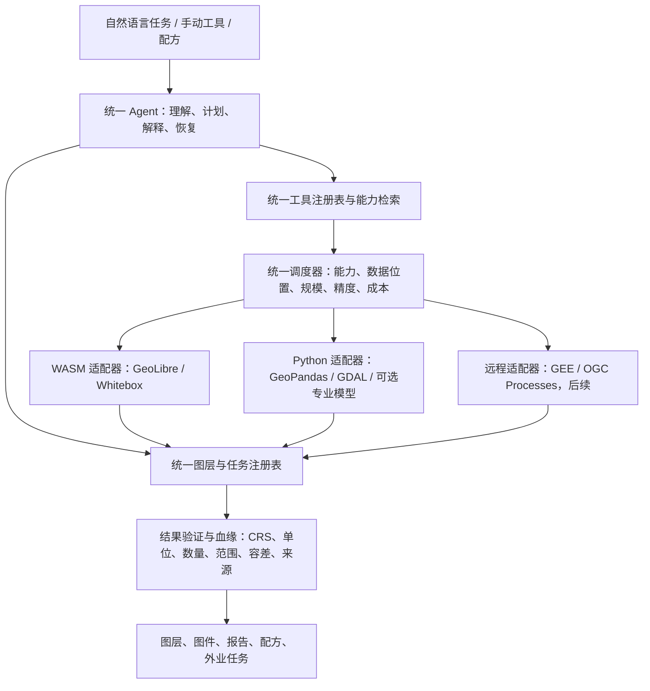

# TIPHYS 下一阶段方案：从“拥有 GIS 工具”转向“可靠完成 GIS 任务”

日期：2026-10-24。主题：AI+GIS。本文是产品与技术路线方案，不把设想写成已实现能力。

## 一、结论先行

TIPHYS 下一阶段不应继续以“接入了多少工具”为主要目标，而应把目标改成：**用户用自然语言提出一个真实 GIS 任务，系统能够选择合适引擎、正确处理数据与坐标、执行长任务、验证结果，并交付可复现的图层、图件、报告和外业任务。**

产品上建议形成一条主线、两个抓手。主线是“统一 Agent + 统一工具与图层注册 + 多引擎执行 + 结果验证”；两个抓手分别是“生态廊道与生态空间分析”领域工作流，以及“桌面分析—手机外业—回传更新”的任务闭环。前者证明 TIPHYS 能完成专业任务，后者证明它不只是把 ArcGIS/QGIS 的按钮搬进聊天框。

生态廊道值得做，但不应把目标写成“原样复制 Linkage Mapper”。Linkage Mapper 的官方实现是公开的，其传统实现依赖 ArcGIS/ArcPy 工具链，并与 Circuitscape 等连通性方法形成配套。TIPHYS 更合理的路线是保留其可靠的分析流程与术语，用现有 Whitebox/GeoLibre、Python 栅格栈和后续可选的 Circuitscape 执行器重新组成可验证工作流。最小成本廊道与电流密度连通性不是同一种结果，产品中必须明确区分。

InVEST 也建议加，但不建议整套搬入。先做与生态廊道能形成数据衔接的生境质量，再做输入相对简单的碳储量；产水、泥沙、授粉等模型等数据准备与结果解释能力成熟后再逐个接入。每一个模型都必须带数据要求检查、参数模板、单位与坐标验证、结果解释和适用边界，而不是只增加一个“运行模型”按钮。

## 二、现状与证据口径

本方案对 TIPHYS 现状的判断来自当前仓库源码与项目文档：系统已有 Tauri 桌面壳、React/MapLibre 工作台、Node Agent sidecar、Python MCP 引擎、浏览器 GeoLibre WASM 运行时、任务与审批、会话恢复、图层与属性表、工具箱和移动 Web 布局。浏览器与桌面手动工具目录已经合并展示大量 WASM 工具，但桌面 Node Agent 主要看到 Python MCP 工具，浏览器 Agent 通过另一套浏览器工具入口执行本地工具。因此，**统一工具目录已经出现，统一任务调度与统一数据血缘还没有真正完成**。

外部项目部分采用已有公开资料和成熟 GIS 架构知识作方向判断，本轮没有逐仓库重新核验所有最新源码与许可证。正式复制代码、打包模型或发布第三方组件前，必须再核对对应版本的许可证、依赖与算法语义；这不影响本方案对路线优先级的判断。

## 三、我们的目标是什么，要怎么做

### 3.1 产品目标

TIPHYS 应成为一个**以任务和结果为中心的 AI+GIS 系统**。它既不是“带聊天框的 GIS”，也不是“能调用很多空间算法的 Agent 演示”。用户购买的应当是可靠完成一件事：制作生态廊道、核查外业样点、完成选址、处理一期遥感影像、解释分析结果，或者把一套成功流程保存下来重复使用。

核心目标可以拆成四层。第一层是理解：Agent 能把自然语言拆成明确的输入、参数、坐标语义、输出与验收条件，缺信息时询问，而不是猜测。第二层是执行：系统按能力、数据位置、数据量和精度要求选择 WASM、Python 或未来远程引擎，并统一展示进度、取消、审批和错误。第三层是验证：结果必须可读、坐标正确、数量与范围合理，必要时进行双引擎对照和敏感性检查。第四层是交付：结果不仅落在地图上，还包括图件、表格、解释、数据血缘、可复用配方和后续外业任务。

### 3.2 评价指标

| 指标 | 含义 | 不采用的替代指标 |
|---|---|---|
| 任务成功率 | 一组固定真实任务从输入到交付的通过比例 | 工具总数、按钮总数 |
| 结果可验证率 | 输出带坐标、数量、范围、几何/栅格检查和血缘的比例 | “工具返回成功” |
| 跨引擎一致性 | 五个试点操作在同数据、同语义下通过容差测试 | 文件逐字节相同 |
| 可恢复性 | 取消、崩溃、断线、错误参数后能够恢复或安全重试 | 单纯不报错 |
| 可复现性 | 一次成功任务可保存为配方并用新数据重跑 | 聊天记录可查看 |
| 外业闭环效率 | 从桌面生成核查任务到手机回传并更新成果的完成度 | 手机端页面数量 |

### 3.3 明确不做

现阶段不追求完整 ArcGIS Pro 对齐，不为全部 WASM 工具编写 Python 对照实现，不做原生手机 App，不把 GEE 未验证能力写成已接通，不引入完整摄影测量、LiDAR、SWAT/HEC/WRF 等大型模型体系，不做高精度 RTK 测量承诺，也不把“大模型生成一段代码并运行”作为默认执行方式。确定性 GIS 计算应由稳定工具完成，LLM 负责理解、编排、解释与恢复。

## 四、哪些地方应当与别人一样做

成熟 GIS 的交互和工程约束不需要刻意差异化。用户已经形成的习惯越标准，TIPHYS 越应该把 AI 的价值放在任务完成上。

| 参照对象 | 应当对齐的做法 | TIPHYS 的落地方式 |
|---|---|---|
| QGIS Processing | 统一算法注册、参数契约、多个执行 provider、统一进度与反馈、输出进入同一工程 | 建立 canonical tool registry；WASM、Python、GEE 是不同 provider，而不是三套产品 |
| ArcGIS Pro Geoprocessing | 工具执行前验证、环境参数、结果与历史、可复用模型 | 增加 preflight、运行环境摘要、任务历史和配方，不复制其界面复杂度 |
| ArcGIS/QGIS 工作台 | 图层树、属性表、符号化、选择、右键菜单、出图与工程文件 | 继续补基础工作台，但按任务需要排优先级，不做全量按钮竞赛 |
| Linkage Mapper / Circuitscape | 源地—阻力—廊道—网络—优先级的专业流程与清晰术语 | 复用流程和可复用算法，不继承 ArcPy 宿主依赖 |
| InVEST | 明确输入表、威胁/参数表、模型输出与适用边界 | 做精选模型向导和数据预检，不做无解释的一键黑箱 |
| QField / Survey123 等外业工具 | 离线任务包、表单约束、照片附件、定位精度记录、同步与冲突处理 | 手机端优先保证采集与核查可靠，不做缩小版桌面 GIS |
| OGC API - Processes | 异步执行、状态查询、取消、结果与错误的清晰语义 | 统一 job 状态机，并为未来远程执行保留标准映射 |
| STAC/COG/PMTiles 等开放生态 | 数据发现、云端友好栅格、离线/在线瓦片与开放格式 | 作为数据访问与性能基础，不自造私有格式 |

这意味着 TIPHYS 会继续使用 GeoPandas、Shapely、GDAL/PROJ、GeoLibre/Whitebox、MapLibre 等成熟组件。通用算法不重写，特色放在统一语义、调度、验证、解释和工作流闭环上。

## 五、哪些地方可以比别人做得好，或者多做一步

### 5.1 真正统一的多引擎 Agent

多数“AI+GIS”项目只有一条执行路径：要么让模型生成 Python 代码，要么调用一组固定工具，要么只操作云端数据。TIPHYS 已经同时具备浏览器 WASM 和桌面 Python，桌面 WebView 还能同时运行两套引擎。这个基础可以形成真正的优势：**Agent 只理解统一 GIS 能力，调度器根据数据位置、引擎能力、数据规模和精度要求选择执行器。**

这比单纯统一参数名更进一步。统一内容应包括工具描述与调用规范、图层和结果引用、任务状态、错误码、验证报告与数据血缘。专用算法保留原生工具 ID，不强行制造虚假的“全引擎一致”。

### 5.2 把“结果验证”做成产品，而不是测试脚本

GIS 软件通常假设用户知道坐标、单位、无效几何和数据格式的影响；通用 AI Agent 则容易把“代码跑完”当成“任务完成”。TIPHYS 可以把两者之间缺失的一层做实：每次任务都有执行前检查、执行后验证和可读的验收结论。

例如，500 米缓冲不能被解释为 500 度；重投影不能只改 CRS 标签；裁剪后要素数异常减少要提示；廊道结果为空要区分是阻力设置、源地位置还是数据范围问题。验证失败时，Agent 应解释原因、提出修复并在确认后重试，而不是只返回堆栈。

### 5.3 从分析结果继续走到图件、报告和外业

多数工具在“生成结果图层”时结束。TIPHYS 可以把任务继续推进到“这个结果说明什么、哪些位置需要实地核查、下一步该做什么”。一次任务可以自动产出图层、统计表、参数与血缘、简明结论、可打印图件，以及一组带位置和调查表单的外业核查点。这个“分析—解释—核查—更新”的闭环，是比增加几十种滤波器更有价值的差异点。

### 5.4 领域工作流，而不是领域工具堆积

生态、环境、测绘用户需要的往往是一条有顺序、有数据要求、有质量控制的工作流。TIPHYS 可以提供少量精心设计的领域包，每个领域包包含数据检查、推荐参数、确定性工具链、结果解释、图件模板和外业任务模板。Agent 在这里负责根据数据与目标调整流程，而不是每次重新发明算法。

### 5.5 本地优先与可信执行

桌面本地数据、浏览器本地计算、用户自己的模型配置、明确的远程执行边界，可以形成隐私与可控性优势。涉及上传、远程 GEE 或跨引擎大规模数据转换时，系统应说明数据去向、估算成本并请求确认；不能为了“自动化”而隐式传输用户数据。

## 六、目标技术架构

### 6.1 统一工具注册表

每个通用工具使用稳定 canonical ID，并同时记录统一语义和各引擎能力。注册项至少包括功能描述、JSON Schema、输入输出类型、单位与 CRS 规则、是否破坏性、各引擎适配器、预计成本、验证器和结果发布方式。专用 Whitebox 算法可以只声明 `wasm` 能力；桌面文件批处理可以只声明 `desktop` 能力。

五个试点操作覆盖矢量几何、坐标转换、属性聚合和栅格—矢量统计，是足够有代表性的最小集合。

| 统一操作 | 必须固定的语义 | 重点验证 |
|---|---|---|
| Buffer | 距离与单位明确；米制距离必须有满足精度要求的投影策略；溶解与否明确 | 坐标单位、缓冲面积/宽度容差、空结果、跨日期变更线限制 |
| Clip | 输入与裁剪图层的空间关系明确；保留字段与几何修复规则明确 | 要素数、范围、无效几何、不同 CRS 的处理 |
| Reproject | 真正转换坐标而非修改标签；输出 CRS、精度与元数据明确 | 控制点误差、要素数不变、显示与分析 CRS 分离 |
| Dissolve | 分组字段、属性聚合、单部件/多部件规则明确 | 分组数量、面积守恒、属性聚合结果 |
| Zonal Statistics | 栅格值与区域几何对齐；像元覆盖、NoData、统计项与面积单位明确 | 同数据双引擎容差、部分覆盖像元、不同 CRS、空区域 |

Zonal Statistics 是一致性压力测试。当前 Python 引擎的 34 个 MCP 工具与浏览器工具路由里都没有分区统计，因此它是五个试点中唯一需要先新增能力、再做双引擎适配的一项；其余四类操作在两套引擎中已有基础实现，但参数与坐标语义并不完全一致。如果某个引擎没有可验证的对应算法，应明确标记能力缺口，并在适配器中实现统一算法或暂时限制执行引擎，不能用近似工具冒充同一契约。

### 6.2 统一图层与结果注册

所有引擎产生的数据都登记到同一个工作区，Agent 只使用统一 layer ID。注册信息至少包含名称、类型、原生 CRS、显示 CRS、几何类型、要素或像元规模、存储位置、所属引擎、数据版本、来源工具、父图层、创建时间和验证状态。显示副本与分析数据继续分离，但对 Agent 暴露为同一个逻辑图层。

调度器执行前先判断数据在哪里、目标引擎能否直接读取、是否需要转换，以及转换是否改变精度。大栅格优先在数据所在引擎处理；跨引擎转换必须记录为新数据版本，不能悄悄替换原图层。

### 6.3 统一任务、错误和审批

任务状态建议采用 `queued / running / waiting_approval / succeeded / failed / cancelling / cancelled / interrupted` 的统一模型，并把“执行成功”和“验证通过”分开记录。错误使用稳定类别，例如输入缺失、参数无效、CRS 不满足、数据过大、引擎不可用、取消、验证失败和远程未授权。Agent 根据错误类别选择询问、修复、换引擎或停止，而不是对所有错误统一重试。

现有桌面 Node Agent 的会话、审批和可靠性能力应保留。落地时不宜推倒重写：先抽出浏览器与桌面共享的工具契约、注册表、验证器和结果模型，再让桌面 Agent 通过统一调度入口调用 Python 与 WebView WASM。Node sidecar 可逐步收敛为模型/凭据与本地服务宿主，但只有在前端统一编排达到同等会话与恢复能力后才迁移，不做一次性替换。

### 6.4 任务结果必须可审计

每次结果应包含输出图层与文件、执行引擎、实际参数、坐标策略、输入数据版本、验证摘要、警告和可复用配方。这样既能让用户复核，也能让 Agent 在后续对话中准确引用“刚才那个结果”，而不是根据聊天文本猜测。

## 七、要不要加其他领域能力

要加，但只加能形成完整任务的能力。优先级应按“用户价值 × 数据可准备性 × 可验证性 × 与主线的协同”排序，而不是按算法名气排序。

| 优先级 | 建议加入 | 形式与理由 |
|---|---|---|
| P0 | 数据体检与坐标/单位向导 | 所有任务的底座；检查 CRS、无效几何、重复、空值、字段类型和范围，并给出可执行修复 |
| P0 | 生态廊道最小工作流 | 与现有 Whitebox 成本距离能力衔接，能展示专业分析、解释与外业闭环 |
| P0 | 外业核查任务包 | 让分析结果进入真实现场，形成手机端存在价值 |
| P1 | 生境质量与碳储量精选工作流 | 与廊道共享土地利用、威胁和统计数据；先做数据预检与模板，不接整套 InVEST |
| P1 | 景观指数与 MSPA 辅助分析 | 用于源地识别、格局评价和廊道前后对比，成本低于再造复杂模型 |
| P1 | STAC/COG 数据发现与遥感指数、时序、变化检测 | 形成“找数据—分析—核查”的遥感任务链；大数据仍遵守本地/远程边界 |
| P1 | 批处理、配方、工程文件、最小出图 | 让成功任务可复用、可交付，是普通 GIS 用户的高频需求 |
| P2 | Circuitscape/Omniscape 电流连通性 | 用于补充最小成本廊道；桌面或授权远程执行，先做小规模验证 |
| P2 | 产水、泥沙、授粉等更多 InVEST 模型 | 输入和解释门槛较高，逐个做，不整套堆入 |
| P2 | 地理配准、DXF/GPX/CSV 测量数据与质量检查 | 服务测绘与历史资料数字化，按真实用户需求排期 |
| 暂缓 | OpenDroneMap、LiDAR、完整测量平差、RTK/NTRIP、SWAT/HEC/WRF、完整 Notebook | 依赖、计算或专业验证成本高，容易偏离 AI+GIS 主线 |

### 7.1 生态廊道建议路线

第一条领域工作流建议命名为“生态连通性与廊道”，而不是直接叫“Linkage Mapper”。标准流程为：数据体检与统一坐标；确定源地或核心斑块；构建并解释阻力面；计算最小成本距离与廊道；提取节点和路径并做网络指标；识别需要现场核查的位置；输出优先级表、图件、报告和外业任务。MSPA 与景观指数可作为源地识别和结果评价的辅助模块，电流方法作为后续增强模块。

阻力面必须有可追溯的权重表和单位规则，并支持至少一组替代权重做敏感性对比。验证不能只靠“地图上看起来有廊道”：应使用已知路径的合成景观测试算法，用真实样例检查源地、阻力、成本距离和输出的空间一致性，并记录不同权重下廊道是否稳定。只有经过这些验证后，才能说明与 Linkage Mapper 的哪些步骤相当、哪些尚未覆盖。

### 7.2 InVEST 建议路线

先生境质量，后碳储量，再按用户需求扩展。生境质量能与廊道的源地和阻力分析共享土地利用、威胁因子与敏感度表；碳储量能展示“空间数据 + 参数表 + 分区统计 + 报告”的通用模式。每个模型都要内置输入模板、字段与单位检查、缺失数据提示和结果解释，不允许 Agent 自行编造生态参数。参数来自用户或明确文献时，应把来源写入任务血缘。

## 八、手机端与电脑浏览器端分别做什么

平台分工应围绕场景，而不是把同一套界面缩放。Tauri 桌面适合本地文件、双引擎和较长任务；电脑浏览器适合免安装的完整分析、分享和云端数据发现；手机适合位置、相机、语音和现场决策。手机浏览器不应承诺可靠后台轨迹、蓝牙 RTK/NTRIP、大栅格 WASM 或复杂布局编辑，这些能力若成为硬需求，应另行评估原生壳，而不是在当前 Web 版本里假装支持。

| 能力 | 手机 Web | 电脑浏览器 | Tauri 桌面 |
|---|---|---|---|
| 外业点、照片、表单、短轨迹与导航到要素 | 核心场景，支持离线任务包与回传 | 可查看和审核 | 可创建任务、管理数据与同步 |
| 语音转结构化属性、现场 AI 质检与异常解释 | 核心 AI 场景，需用户确认，不伪造识别置信度 | 可用 | 可用 |
| 矢量轻编辑、属性核查、前后对比 | 只做必要的小修改 | 完整支持 | 完整支持 |
| 大型栅格、阻力面、廊道、InVEST、批处理 | 不做，只看结果与核查任务 | 适合中小数据与 WASM；超限明确提示 | 主执行环境，可选 Python/WASM/远程 |
| 出图、报告、配方与数据血缘 | 查看、分享、现场核对 | 完整支持 | 完整支持 |
| 后台连续定位、高精度外接 GNSS | 不承诺 | 不适用 | 未来按需求评估专用原生能力 |

手机端的最小闭环应是：桌面 Agent 根据分析结果生成核查点和表单；用户下载包含底图、矢量、任务与规则的离线包；手机在现场采集位置、照片、语音和表单，并立即做必填、范围、位置和重复检查；恢复网络后回传；桌面把回传记录与原任务关联，Agent 汇总异常、更新图层和报告。离线期间 AI 不可用时要明确降级为规则校验，不能把未执行的智能检查写成已完成。

## 九、分阶段实施路线

| 阶段 | 交付内容 | 验收门槛 |
|---|---|---|
| A：可靠任务底座 | 统一工具与图层注册、统一任务/错误模型、五个试点操作、执行前后验证、血缘记录 | 五操作在同数据上按语义通过双引擎或明确能力边界测试；错误 CRS/单位能被阻止；结果可追踪 |
| B：可交付工作台 | 数据体检、批处理、配方、工程文件、最小出图与结果解释报告 | 一次成功任务可保存并用新数据重跑；报告中的数字来自工具结果而非模型编造 |
| C：生态连通性领域包 | 源地、阻力、最小成本廊道、网络结果、敏感性对比、图件与报告 | 合成景观和真实样例均有验证；明确与 Linkage Mapper/Circuitscape 的覆盖差异 |
| D：手机外业闭环 | 离线任务包、定位/照片/语音/表单、同步冲突、回传更新 | 飞行模式可采集，恢复网络后可回传；重复与冲突不静默覆盖 |
| E：数据与模型扩展 | STAC/COG 遥感流程、生境质量/碳储量、可选 Circuitscape、真实 GEE 链路 | 每个扩展独立完成数据预检、结果验证和适用边界说明后才上线 |

阶段 A 不应等到“所有架构都设计完美”才开始。第一批代码就可以只落地统一注册表、Buffer 与 Reproject 两个操作及验证报告，再补齐 Clip、Dissolve、Zonal Statistics。与此同时可以用一个真实生态样例做廊道技术验证，但在底座完成前不把它包装成正式一键功能。

## 十、建议首先做给用户的完整示例

建议第一条演示任务不是“给点做 500 米缓冲”，而是：

> “根据这片土地利用、道路、居民点和 DEM，分析核心栖息地之间的生态廊道，指出最不稳定的路段，生成一张成果图和一份外业核查清单。”

系统应先检查坐标、分辨率和数据缺口，向用户确认源地与阻力权重；随后选择合适引擎执行，输出廊道与优先级结果，并给出验证和敏感性摘要；最后生成图件、报告和可离线下载的外业核查点。手机回传现场照片和表单后，桌面成果能够更新。这个示例同时证明统一调度、专业 GIS、结果验证、AI 解释和移动闭环，是 TIPHYS 最应该建立的产品记忆点。

## 十一、主要风险与控制方式

最大的技术风险是把“接口统一”误当成“算法一致”，因此五个试点必须先定义语义和容差，再谈推广。最大的产品风险是领域包过多导致每个都不可信，因此每个阶段只交付可验证的完整工作流。最大的数据风险是阻力权重、生态参数和模型解释被 Agent 编造，因此这些参数必须来自用户、模板或有来源的记录。最大的移动端风险是把浏览器定位、离线和后台能力说得过强，因此所有降级都要在界面和任务结果中明确显示。最大的工程风险是一次性替换现有 Node Agent 与 Python 引擎，因此采用共享契约和适配器的渐进迁移，保留现有测试与回退路径。

## 十二、下一批建议

下一批建议直接进入“统一任务底座 A1”：实现 canonical tool contract、统一 layer/provenance 摘要、统一验证结果模型，并用 Buffer 与 Reproject 做首批双引擎适配；同时补数据体检中最关键的 CRS、单位、无效几何和空结果检查。完成后再扩展其余三个试点操作，并启动生态廊道合成样例验证。这样既不停止产品推进，也不会在底座未稳时继续叠加难以验证的领域功能。
